

<a href="https://rbchy.github.io/rbchy/" title="Visit my website">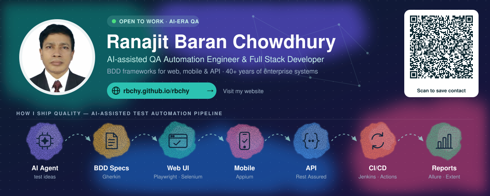</a>

<!-- ============ STATUS BAR ============ -->

[-2dd4bf?style=for-the-badge&logo=apple&logoColor=white)](https://rbchy.github.io/rbchy/download.html)

---

## 📌 At a Glance

<table>
<tr>
<td width="50%" valign="top">

**🙋 Who I am**

QA Automation Engineer / SDET. I build the test system around an application: API, contract, UI, accessibility, performance and security tests that run as **quality gates in CI** (GitHub Actions and Jenkins), plus the QA documents that turn the results into a release decision. Backed by **four decades** of enterprise systems work, from container terminal management (NAVIS SPARCS N4) and GMP pharmaceutical packaging operations to modern web, mobile and API automation.

> *"Quality is never an accident; it is always the result of intelligent effort."*

</td>
<td width="50%" valign="top">

**📍 Quick facts**

| | |
|---|---|
| 📍 **Location** | West Norriton, PA 19403, USA |
| 📧 **Email** | chyranajit@gmail.com |
| 📞 **Phone** | +1 (267) 342-5565 |
| 💼 **Open to** | Full-time · Internship · Contract · Freelance |
| 📄 **Resume** | [ATS-friendly resume](https://rbchy.github.io/rbchy/resume.html) · [PDF](https://rbchy.github.io/rbchy/resume.pdf) |
| 🌐 **Mode** | Remote-first, flexible time zones |

</td>
</tr>
</table>

---

## ✅ Latest Results (November 2026 CI sweep)

Every repository now runs its own checks in **GitHub Actions** on every push to `main`. Numbers come from
[`data/portfolio.json`](data/portfolio.json), the same file that draws the status board, and CI checks that this README,
the website and the resume agree with it.

| Metric | Value |
|---|---|
| 📦 Public repositories | **37** (35 with automated tests, 2 profile / portfolio repositories) |
| 🟢 Green CI on `main` | **37 / 37** |
| 🧪 Automated tests | **5,216** |
| 🛍️ RbcTcsWorld Shop | 2,039 tests (2,034 passed, 5 skipped by design) · 19 / 19 gates · 0 flaky |
| ⭐ E-Commerce Suite | 1,489 tests · 18 / 18 gates · 89.3 % mutation score |
| 💼 Payroll (desktop + MySQL) | 260 / 260 and 160 / 160 against a real MySQL 8 in CI |
| 📱 Appium Mobile Automation | 22 device tests on an Android emulator + 8 unit tests |
| 🌲 Amazon Cypress | 39 / 39 in Chrome, Firefox and Edge |
| 🎭 QA Brains Python + Playwright | 15 / 15 in Chromium and Firefox |
| 🎭 QA Brains TypeScript + Playwright | 15 / 15 |

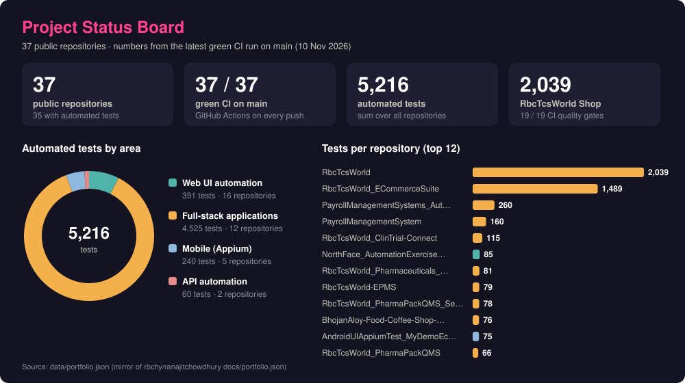

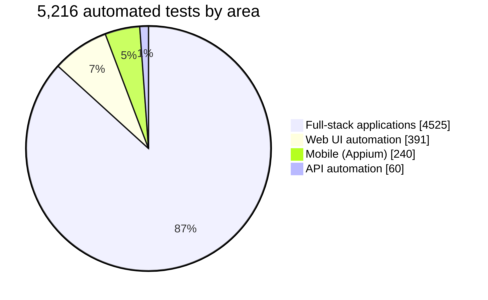

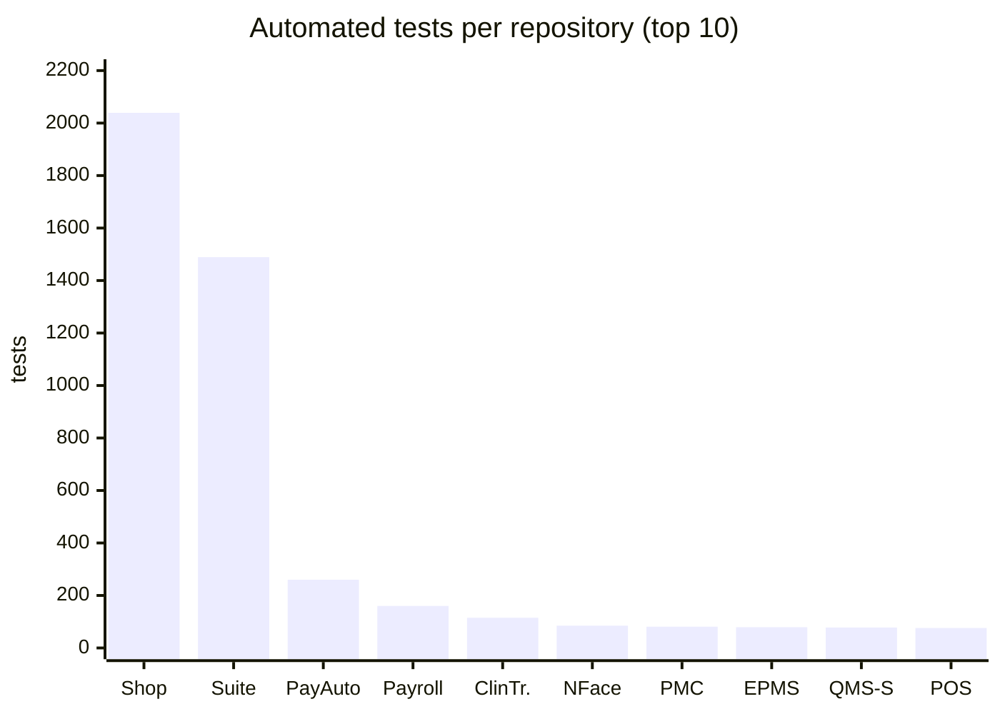

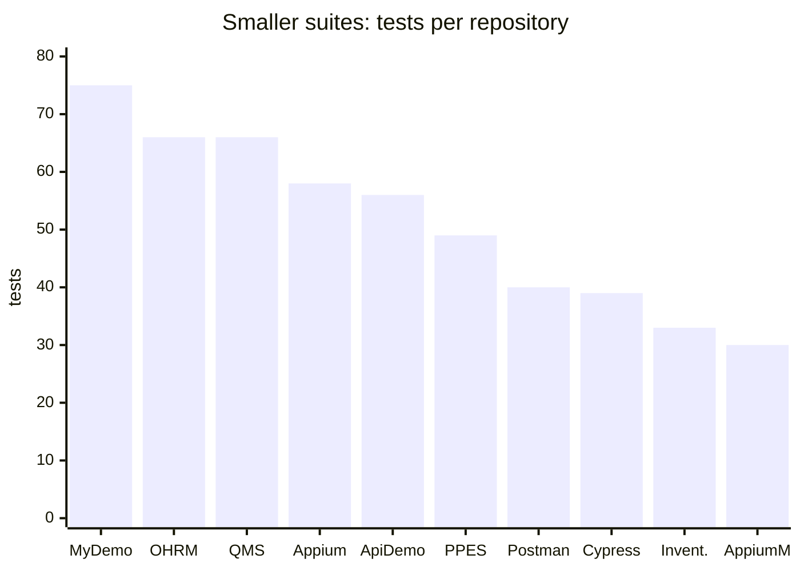

### What the November sweep fixed

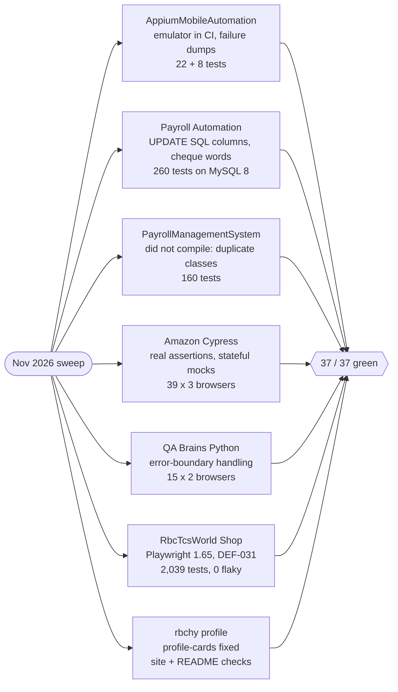

Each fix was checked the hard way: a planted bug on a throw-away branch had to turn the tests red before the fix was merged.

---

## ⭐ Flagship Project: RbcTcsWorld E-Commerce Suite

**[RbcTcsWorld_ECommerceSuite](https://github.com/rbchy/RbcTcsWorld_ECommerceSuite)** — an Amazon-inspired online store
(Spring Boot 4.1 · Java 21 · PostgreSQL · React) built *to be tested*. The storefront has a full store back office
(products, coupons, orders, payments, returns, reviews, customer accounts, multi-warehouse inventory, eight printable reports with CSV export, advanced search), six languages including right-to-left Arabic, and installs as a desktop app. Sessions use rotating refresh tokens with theft detection; the login
lockout is shared by every backend instance through Redis. Payments run on Stripe (contract-tested against
Stripe's own mock on every build) and every order step sends an e-mail through a transactional outbox. Every order
ships to a validated US address, a forgotten password is reset by a single-use e-mailed link, and every product, order, coupon and customer change lands in an append-only, hash-chained audit trail inspired by 21 CFR Part 11 / ALCOA+.
Shoppers also get guest checkout, an address book, a faceted filter panel, flash deals with a countdown, "customers also bought", invoice PDFs, optional two-factor sign-in by e-mailed code and a saved-card wallet that keeps only a provider token, never the card number. The application is the test object; the work
is the test system around it.

| Layer | What gates every push | Latest result |
|---|---|---|
| Unit + integration | JUnit 5, Mockito, JaCoCo (>= 97 % lines, >= 88 % branches) | 772 / 772 · 97.3 % / 94.2 % |
| API, DB, BDD, UI | REST Assured, JDBC, Cucumber 7, Selenium 4 (Page Objects), e-mails read from Mailpit | 444 / 444 |
| Test quality | PIT mutation testing (>= 84 %) | 89.3 %, test strength 94.7 % |
| API contract | 12 strict JSON Schemas + OpenAPI breaking-change gate | 0 breaking changes |
| Accessibility | axe-core, WCAG 2.1 AA, 23 pages | 0 serious / critical |
| Cross-browser | Chrome, Firefox, Edge (CI matrix), Safari via Jenkins | 59 / 59 in Firefox and Edge |
| Playwright (TypeScript) | Chromium, Firefox, WebKit, Pixel 7, iPhone 14; network mocking, visual regression, traces | 262 / 262 (+3 skipped by design) |
| Real phone browsers | Appium 3: Chrome on an Android emulator, Safari on an iOS Simulator, same page objects | 4 / 4 on each phone |
| Payments | Stripe consumer contract (stripe-mock), recorded Stripe answers, idempotency keys | 0 double charges |
| E-mails | Transactional outbox, real SMTP into Mailpit, 2 backends never send twice | 1 e-mail per event |
| Performance | k6 smoke, 60-buyer flash sale, catalog, with SLO thresholds | 0 % errors, no overselling |
| Security | OWASP ZAP API scan, SBOM-based OSV scan with self-test, JWT / RBAC / IDOR tests, refresh-token theft detection, Redis lockout across 2 backends | 0 Medium/High, 0 vulnerable libraries |
| Delivery | Docker Compose stack, GitHub Actions + Jenkins (macOS ARM) | 63 / 63 smoke tests |
| Acceptance (UAT) | 10 goal-based tasks for non-tester users, each traced to its requirements; GO / NO-GO sign-off | plan ready, sessions next |

**What the tests found** (28 documented defects, each with root cause, fix and regression test): a dependency scanner that went silently blind on a rate limit (found by a runner canary), a test that could
never fail (found by mutation testing), a brute-force and account-enumeration gap, 21 vulnerable libraries, an
unpaginated catalog (p95 22 → 9 ms after the fix), a search race in the UI, a 500 on malformed query strings,
WCAG failures on all 8 original storefront pages (fixed test-first), a QA dashboard that showed a failed Jenkins build as
green, a Safari-only keyboard bug that made every form test type nothing, and a broken product picture that
left an empty frame only in Safari (found by Playwright on WebKit), and a UI search helper that waited for
nothing on a slow Safari run (found by Jenkins on the Mac).

**QA documents:** [Test Strategy](https://github.com/rbchy/RbcTcsWorld_ECommerceSuite/blob/main/docs/qa/TEST_STRATEGY.md) ·
[Risk Register](https://github.com/rbchy/RbcTcsWorld_ECommerceSuite/blob/main/docs/qa/RISK_REGISTER.md) ·
[Traceability (129 requirements)](https://github.com/rbchy/RbcTcsWorld_ECommerceSuite/blob/main/docs/qa/TRACEABILITY_MATRIX.md) ·
[Defect Reports](https://github.com/rbchy/RbcTcsWorld_ECommerceSuite/blob/main/docs/qa/DEFECT_REPORTS.md) ·
[Test Summary Report](https://github.com/rbchy/RbcTcsWorld_ECommerceSuite/blob/main/docs/qa/TEST_SUMMARY_REPORT.md) ·
[UAT Plan](https://github.com/rbchy/RbcTcsWorld_ECommerceSuite/blob/main/docs/qa/UAT_PLAN.md)

**Engineering:** [9 Architecture Decision Records](https://github.com/rbchy/RbcTcsWorld_ECommerceSuite/tree/main/docs/adr) ·
one-command workflow (`make app`, `make test`, `make playwright`, `make doctor` checks the machine first) ·
[Contributing guide](https://github.com/rbchy/RbcTcsWorld_ECommerceSuite/blob/main/CONTRIBUTING.md) ·
[MIT License](https://github.com/rbchy/RbcTcsWorld_ECommerceSuite/blob/main/LICENSE)

### CI/CD: two pipelines, one set of gates

Every change goes through a pull request; nothing reaches `main` until all checks are green.

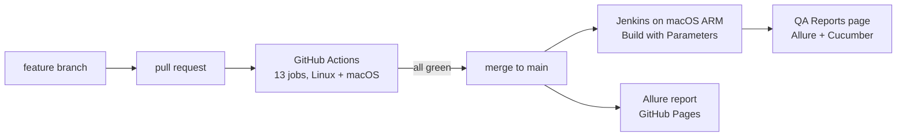

| | GitHub Actions (cloud) | Jenkins (my Mac, Apple Silicon) |
|---|---|---|
| Runs | every push and pull request | on demand: `BROWSER` = chrome / firefox / edge / safari, `RUN_PLAYWRIGHT`, `PHONE` = ios-safari / android-chrome |
| Jobs | backend + coverage, mutation (PIT), API + DB + BDD + UI on PostgreSQL, cross-browser, Playwright, Appium on an Android emulator and an iOS Simulator, ZAP + OSV security, Docker Compose smoke, public demo stack, Jenkinsfile lint, Allure publish | same stages from one `Jenkinsfile`, plus Safari |
| Safeguards | pinned runner image + a canary on the next image | JDK 21 pinned as a Jenkins tool, per-stage timeouts, Docker and Safari readiness checks before tests start |
| Reports | Allure on GitHub Pages | QA Reports page that is never greener than the build |
| Latest | all checks green on `main` | Chrome #67, Firefox #68 and Edge #69 (Oct 2026): all gates passed; the display is kept awake during Safari runs (`caffeinate`) |

Running the same tests on a second CI system, OS and CPU found real problems that one pipeline hid: six
defects came only from Jenkins on the Mac (DEF-014, DEF-015, DEF-022, DEF-024, DEF-025, DEF-027).

---

## 🛍️ RbcTcsWorld Shop: the suite's code on its way to a live store

**[RbcTcsWorld Shop](https://github.com/rbchy/RbcTcsWorld)** takes the E-Commerce Suite's code, with its full history and
its quality bar, through what a real store needs. **The plan: affiliate first, own shop later.** The site goes live first
as an Amazon affiliate site (one setting, `STORE_SALES=off`: hand-picked partner products with my own short reviews,
bought at Amazon, nothing sold on the site itself); everything the own shop needs is already built and tested and opens
with `STORE_SALES=on`.

| Built for the live store (each with its tests, a traced requirement and a decision record) | |
|---|---|
| Card payments with Stripe Elements and signed webhooks: card numbers never reach the server | ✅ |
| Stripe Tax by delivery address, recorded after payment, reversed on refunds, product tax codes | ✅ |
| Shippo labels and carrier tracking from each product's weight and box; prepaid return labels | ✅ |
| E-mail from the store's own domain (Amazon SES), bounce suppression, HTML twin of every e-mail | ✅ |
| Production stack: encrypted off-site backups, weekly restore drill, health alerts | ✅ |
| Policy pages from the shop's own settings; the policy version kept on every order; self-service account deletion | ✅ |
| Product photo upload (EXIF/GPS stripped), contact form with tickets, search-engine pages and sitemap | ✅ |
| Amazon partner products with the required disclosure, and the affiliate-only site mode | ✅ |
| Go live as an Amazon affiliate site (server, domain, products, Associates application) | 🟡 now |
| Own shop: products, LLC and sales tax license, user acceptance test with real cards | ⏳ later |

**Numbers from the main CI run of 10 Nov 2026:** 2,039 automated tests (1,164 backend, 464 API · DB · BDD · Selenium UI,
403 Playwright on five browsers and devices, 8 Appium phone tests), all 19 CI gates green (14 / 14 jobs, iOS included),
0 flaky tests, 26 architecture decision records, 31 documented defects, 36 merged pull requests. Guides for every step
are written in Bangla for the owner.

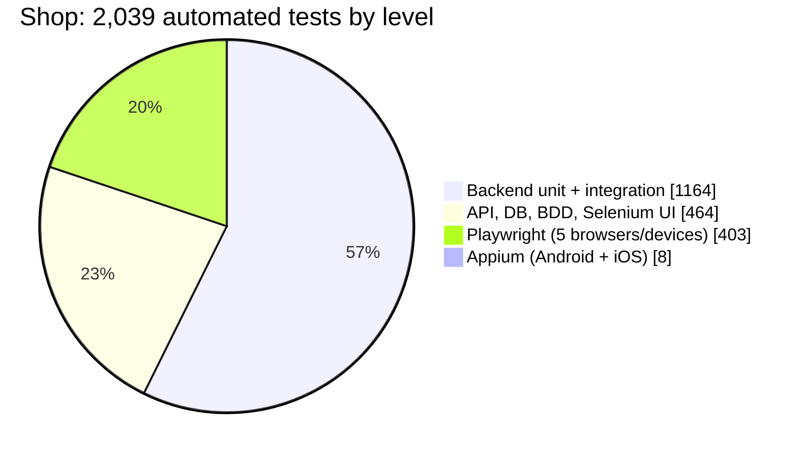

Latest fix, **DEF-031**: a product-photo upload failed when the server answered *429 busy*, which made one Playwright test flaky.
The upload now honours `Retry-After` and tries again (at most 4 times, waits capped at 5 s); two regression tests fail without the fix.

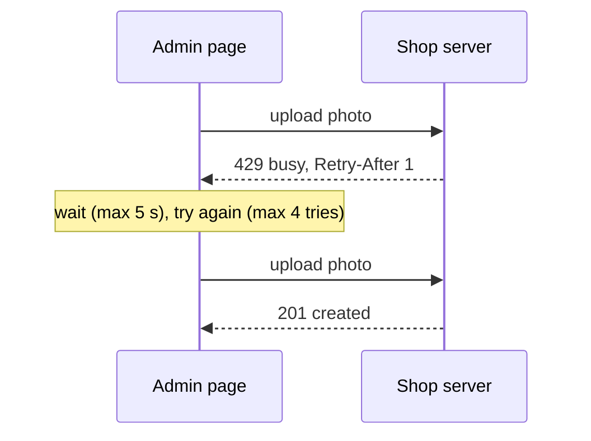

---

## 🧰 Tech Stack

**Languages** 

**Testing & Automation** 

**Quality Engineering** 

**CI/CD, Cloud & Tools** 

---

## 📈 Skill Proficiency

| Area | Level | Experience |
|------|-------|-----------|
| ☕ **Java** | `████████████████████` Expert | 10+ yrs |
| 🐍 **Python** | `████████████████░░░░` Advanced | 5+ yrs |
| 🟦 **TypeScript** | `████████████████░░░░` Advanced | 4+ yrs |
| 🟨 **JavaScript** | `████████████░░░░░░░░` Intermediate | 3+ yrs |
| 🗄️ **SQL** | `████████████████░░░░` Advanced | 5+ yrs |
| 🎭 **Playwright** | `████████████████████` Expert | TS · Python · Java |
| 🌐 **Selenium WebDriver** | `████████████████████` Expert | Java · Python |
| 🥒 **Cucumber / BDD** | `████████████████████` Expert | JVM · JS · Behave |
| 📱 **Appium (Mobile)** | `████████████████░░░░` Advanced | Android · UiAutomator2 |
| 🌲 **Cypress** | `████████████░░░░░░░░` Intermediate | JS · TS |
| 🔌 **API (Postman / Rest Assured)** | `████████████████████` Expert | REST · OAuth 2.0 |
| ⚙️ **CI/CD (Jenkins / GH Actions)** | `████████████████░░░░` Advanced | Pipelines · PR gates |
| ☁️ **Cloud (Sauce Labs / AWS)** | `████████████████░░░░` Advanced | 700+ browser/OS combos |
| 🧬 **Test quality (JaCoCo / PIT)** | `████████████████░░░░` Advanced | Coverage + mutation gates |
| 📜 **Contract & accessibility** | `████████████████░░░░` Advanced | JSON Schema · OpenAPI diff · axe-core |
| 🛡️ **Performance & security** | `████████████████░░░░` Advanced | k6 · OWASP ZAP · OSV |

<strong>🔎 Full technical skills matrix</strong>

### UI Automation & Testing Frameworks

| Framework | Language | Expertise | Use Case |
|-----------|----------|-----------|----------|
| Playwright | TypeScript, Python, Java | Expert | Modern, fast, reliable browser automation |
| Selenium WebDriver | Java, Python | Expert | Legacy and modern web applications |
| Cucumber | Java, Cucumber-JS | Expert | BDD feature files and test execution |
| Behave | Python | Advanced | Python-based BDD automation |
| TestNG | Java | Expert | Test execution, reporting, data-driven testing |
| JUnit | Java | Advanced | Unit and integration testing |
| Cypress | JavaScript, TypeScript | Intermediate | E2E testing for web applications |
| Appium | Java | Advanced | Android native app automation |

### API Testing & REST Automation

| Tool | Expertise | Use Cases |
|------|-----------|----------|
| Postman / Newman | Expert | Collections, environments, CI/CD integration |
| Rest Assured | Expert | REST API automation with Java + TestNG |
| Swagger / OpenAPI | Advanced | API specification; breaking-change gate with openapi-diff |
| JSON Schema | Advanced | Consumer-side contract tests (REST Assured json-schema-validator) |
| Insomnia | Intermediate | REST API testing and debugging |
| GraphQL | Intermediate | GraphQL endpoint testing |

### Build, CI/CD & Cloud

| Tool | Proficiency | Notes |
|------|------------|-------|
| Maven | Expert | Dependency management, plugins, profiles |
| Gradle | Advanced | Build automation |
| npm | Advanced | Playwright / Cucumber-JS / Cypress projects |
| Jenkins | Expert | Pipelines, scheduling, parallel runs |
| GitHub Actions | Advanced | PR checks, scheduled test runs |
| Docker | Intermediate | Containerized test execution |
| Sauce Labs | Expert | Cross-browser cloud, video on failure |
| AWS (EC2 / S3 / CloudWatch) | Intermediate | Cloud test infrastructure |

### Quality Engineering

| Area | Tools | Use Case |
|------|-------|----------|
| Mutation testing | PIT (pitest) | Proves tests fail when the code is wrong; score gate in CI |
| Coverage | JaCoCo | Line and branch gates |
| Performance | k6 | Smoke, load, stress, spike, soak, flash-sale concurrency with SLO thresholds |
| Security | OWASP ZAP, OSV-Scanner | DAST API scan, dependency CVE gate |
| Accessibility | axe-core (Selenium) | WCAG 2.1 A/AA checks per page |
| QA documentation | IEEE 829 / ISO 29119 style | Strategy, plan, risk register, RTM, defect reports, test summary (go / no-go) |

### Reporting & Management

| Tool | Expertise |
|------|-----------|
| Allure Reports | Expert |
| ExtentReports | Advanced |
| Cucumber HTML / TestNG Reports | Advanced |
| Jira · Confluence · TestRail | Expert · Advanced · Advanced |

### Databases

| Database | Proficiency |
|----------|------------|
| MySQL | Expert |
| Oracle · PostgreSQL · DataFlex | Advanced |
| MongoDB · Firebase | Intermediate |

### Environments

| Category | Platforms |
|----------|-----------|
| **OS** | Windows (Expert) · macOS · Linux/Ubuntu (Advanced) |
| **IDEs** | IntelliJ IDEA · Eclipse · VS Code · NetBeans |
| **Browsers** | Chrome · Firefox · Safari · Edge · mobile browsers |
| **Version Control** | Git · GitHub · GitLab · Bitbucket |

---

## 🗺️ Skills Map

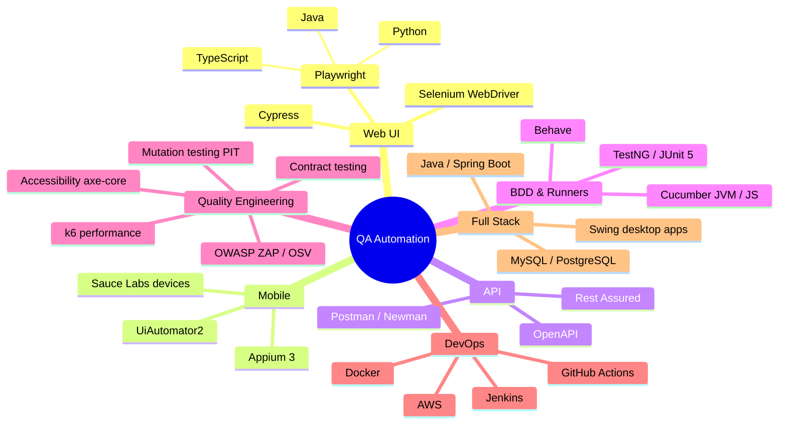

---

## 🏗️ How I Build Automation Frameworks

Every featured framework follows the same layered, maintainable architecture:

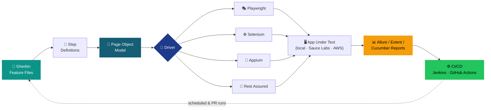

---

## 🚦 Project Status Board

The board image is drawn from `data/portfolio.json` by [`tools/make_status_svg.py`](tools/make_status_svg.py) (shown above in Latest Results); CI fails if it is out of date.

Live **last-commit** badges update automatically from GitHub; test results are from the latest green CI run on `main` (10 Nov 2026).

| Project | Stack | Test Results | Last Activity |
|---------|-------|-------------|---------------|
| 🛍️ [RbcTcsWorld Shop](https://github.com/rbchy/RbcTcsWorld) | Java 21 · Spring Boot 4.1 · React · Stripe · Shippo · Amazon SES |    |  |
| ⭐ [E-Commerce Suite](https://github.com/rbchy/RbcTcsWorld_ECommerceSuite) | Java 21 · Spring Boot 4.1 · REST Assured · Selenium · Playwright · Appium · k6 |    |  |
| 🔬 [QA Brains — Python + Playwright](https://github.com/rbchy/QaBrainsAutomationPythonPlawright) | Python · Playwright · Behave · Allure |   |  |
| 🔬 [QA Brains — TypeScript + Playwright](https://github.com/rbchy/QaBrainsAutomationTypeScriptPlaywright) | TS 5 · Playwright · Cucumber.js |   |  |
| 🔬 [QA Brains — Java + Playwright](https://github.com/rbchy/QaBrainsAutomationJavaPlaywright) | Java 17 · Playwright · Cucumber JVM · TestNG |  |  |
| 📱 [Appium Mobile Automation](https://github.com/rbchy/AppiumMobileAutomation) | Java · Appium 2 · TestNG · Allure · Android emulator in CI |   |  |
| 🏥 [OpenEMR Healthcare](https://github.com/rbchy/OpenEMR_Automation) | Java · Selenium · Cucumber · TestNG |  |  |
| ☁️ [Sauce Labs Cloud Automation](https://github.com/rbchy/QaBrainsSauceLabAPI_Automation) | Java · Selenium · Cucumber · Sauce Labs |  |  |
| 🔌 [API — Rest Assured](https://github.com/rbchy/QaBrainsAPIAutomationRestAssured) | Java · Rest Assured · TestNG |  |  |
| 🔌 [API — Postman / Newman](https://github.com/rbchy/QaBrainsAPIAutomation_Postman) | Postman · Newman |  |  |
| 🧪 [ClinTrial-Connect](https://github.com/rbchy/RbcTcsWorld_ClinTrial-Connect) | Spring Boot · Java |  |  |
| 💼 [Payroll Automation (Java + MySQL + Selenium)](https://github.com/rbchy/PayrollManagementSystems_Automation_Java_MySql_Selenium) | Java 21 · Swing · MySQL 8 · Cucumber · AssertJ-Swing |   |  |
| 🌲 [Amazon Cypress](https://github.com/rbchy/Amazon-Cypress-JavaScript-Automation) | JavaScript · Cypress 14 · Cucumber |  |  |
| 💼 [Payroll Management System](https://github.com/rbchy/PayrollManagementSystem) | Java 21 · Swing · MySQL 8 · JDBC · JUnit 5 |   |  |
| 🏭 [PPES Pharma Packaging](https://github.com/rbchy/PPES-Pharmaceutical-Packaging-Management) | Java 17 · MySQL 8 · DAO/MVC |  |  |

Legend:  latest green CI run on `main` ·  tests that need a real outside service, each with its reason

---

## 📂 Featured Automation Projects

<strong>🛒 RbcTcsWorld E-Commerce Suite — Spring Boot + full test system (flagship)</strong>

 

**Stack:** Java 21 · Spring Boot 4.1 · PostgreSQL · Redis · React · JUnit 5 · REST Assured · Selenium 4 · Playwright (TypeScript) · Appium 3 · Cucumber 7 · k6 · OWASP ZAP · PIT · Docker · GitHub Actions · Jenkins
**Scope:** catalog, cart, checkout with coupons, tax and a delivery address, Stripe payments, order e-mails, password reset by e-mail, order state machine, shipping and public tracking, returns and refunds, verified-purchase reviews, wishlist, store-admin panel, six-language storefront with help center, installable desktop app (PWA + one-click launchers)
**Repo:** [RbcTcsWorld_ECommerceSuite](https://github.com/rbchy/RbcTcsWorld_ECommerceSuite) · **Reports:** [Allure](https://rbchy.github.io/RbcTcsWorld_ECommerceSuite/)

<strong>🔬 QA Brains Automation — Python · TypeScript · Java (Playwright)</strong>

 

| Variant | Stack | Highlights |
|---------|-------|-----------|
| [**Python**](https://github.com/rbchy/QaBrainsAutomationPythonPlawright) | Python 3.9+ · Playwright · Behave · Allure · POM | 15 / 15 in Chromium and Firefox · pytest unit tests · error-boundary handler · screenshot on failure |
| [**TypeScript**](https://github.com/rbchy/QaBrainsAutomationTypeScriptPlaywright) | TS 5.x · Playwright (async/await) · Cucumber.js · Node.js | 15 / 15 · CI with GitHub Actions |
| [**Java**](https://github.com/rbchy/QaBrainsAutomationJavaPlaywright) | Java 17+ · Playwright · Cucumber JVM · TestNG · Maven | 15 / 15 · Gherkin feature files · data-driven · TestNG + Allure reports |

<strong>📱 Mobile and Cypress — Appium on an emulator, Cypress in three browsers</strong>

 

| Repository | Stack | Latest result |
|---|---|---|
| [AppiumMobileAutomation](https://github.com/rbchy/AppiumMobileAutomation) | Java · Appium 2 · UiAutomator2 · TestNG · Allure | 22 device tests on an Android emulator (API 33) + 8 unit tests; screenshot and page source on every failure |
| [AndroidUIAppiumTest_MyDemoEcommerce](https://github.com/rbchy/AndroidUIAppiumTest_MyDemoEcommerce) | Java 17 · Appium · TestNG | 75 / 75 on an emulator |
| [Amazon-Cypress-JavaScript-Automation](https://github.com/rbchy/Amazon-Cypress-JavaScript-Automation) | Cypress 14 · Cucumber · ESLint | 39 / 39 in Chrome, Firefox and Edge; planted-bug check caught 4 scenarios |

<strong>🏥 OpenEMR Healthcare Automation — Selenium + Java + Cucumber</strong>

 

**Stack:** Java · Selenium WebDriver · Cucumber · TestNG · Maven · Jira
**Scope:** patient management, authentication, navigation, form validation, medical records access, role-based access control, appointment scheduling
**Live site:** [demo.openemr.io](https://demo.openemr.io) · **Repo:** [OpenEMR_Automation](https://github.com/rbchy/OpenEMR_Automation)

<strong>☁️ Sauce Labs Cloud Automation — Selenium + Java + Cucumber</strong>

 

**Stack:** Java · Selenium WebDriver · Cucumber · TestNG · Sauce Labs (700+ browser/OS combinations) · Maven · Jenkins
**Coverage:** Chrome, Firefox, Safari, Edge on Windows/macOS/Linux · desktop & mobile viewports · video on failure · Jenkins pipeline with 20+ parallel browser/OS combinations
**Repo:** [QaBrainsSauceLabAPI_Automation](https://github.com/rbchy/QaBrainsSauceLabAPI_Automation)

<strong>🔌 API Testing Framework — Postman + Rest Assured</strong>

 

**Stack:** Postman Collections · Newman · Rest Assured (Java) · TestNG · Maven · JSON/XML · OAuth 2.0
**Coverage:** positive/negative cases · auth flow validation · data-driven datasets · response-time and header checks · Dev/Staging/Prod environment config
**Repos:** [QaBrainsAPIAutomationRestAssured](https://github.com/rbchy/QaBrainsAPIAutomationRestAssured) · [QaBrainsAPIAutomation_Postman](https://github.com/rbchy/QaBrainsAPIAutomation_Postman)

<strong>💼 Payroll Management System — Java Swing + MySQL (160 + 260 tests)</strong>

 

**Stack:** Java 21 · Swing · MySQL 8 · JDBC · JUnit 5 · Maven · GitHub Actions with a real MySQL service
**Features:** employee records (add, view, update, search, delete) · pay engine: normal pay for the first 40 h, overtime ×1.5, double time ×2, extended / holiday / special-work hours, bonus, 20 % tax, 10 % medical · payslip and cheque with the amount in words · login
**Tests:** 160 / 160 in this repository and 260 / 260 in the [automation project](https://github.com/rbchy/PayrollManagementSystems_Automation_Java_MySql_Selenium) (SQL-against-schema checks, MySQL integration, Swing UI with AssertJ-Swing on a virtual display)
**Repos:** [PayrollManagementSystem](https://github.com/rbchy/PayrollManagementSystem) · [PayrollManagementSystems_Automation_Java_MySql_Selenium](https://github.com/rbchy/PayrollManagementSystems_Automation_Java_MySql_Selenium)

<strong>🏭 Pharmaceutical Packaging Inventory Management — Java + MySQL</strong>

 

**Stack:** Java 17+ · MySQL 8.0+ · JDBC + MySQL Connector/J 9.7.0 · DAO + Service + MVC
**Modules:** material inventory CRUD · supplier management with performance ratings · real-time stock dashboard · transaction audit trail · purchase orders · low-stock alerts
**Repo:** [PPES-Pharmaceutical-Packaging-Management](https://github.com/rbchy/PPES-Pharmaceutical-Packaging-Management)

---

## 🥧 Portfolio Breakdown

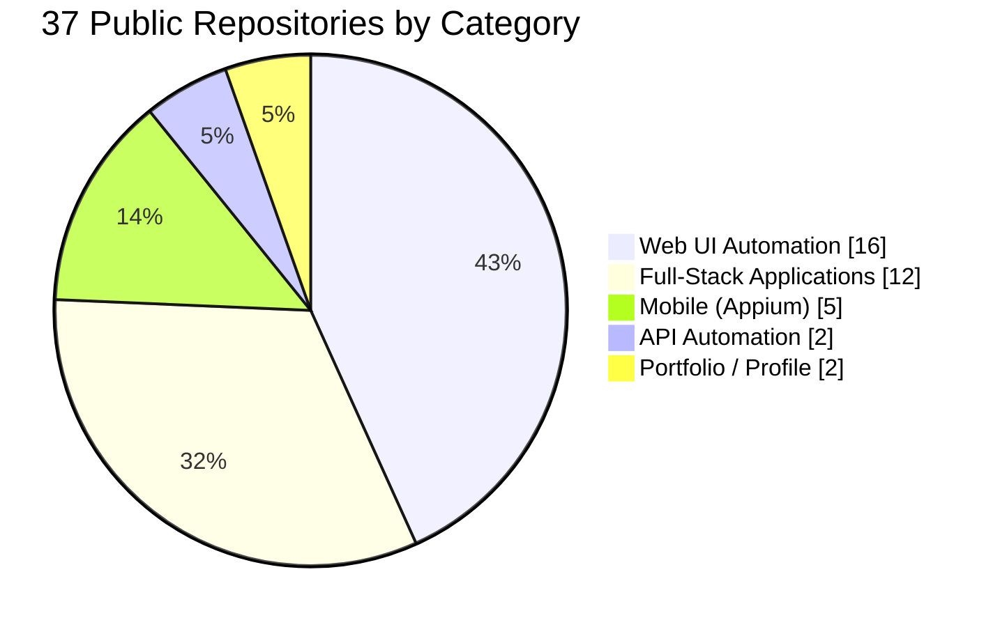

<strong>📦 Click to expand the full list of 37 repositories</strong>

| # | Repository | Category | Description |
|---|-----------|----------|-------------|
| 1 | [Amazon-Cypress-JavaScript-Automation](https://github.com/rbchy/Amazon-Cypress-JavaScript-Automation) | 🌐 Web | E2E framework for Amazon.com — Cypress 14 + Cucumber BDD |
| 2 | [AmazonSeleniumTest](https://github.com/rbchy/AmazonSeleniumTest) | 🌐 Web | Selenium test for Amazon |
| 3 | [AndroidUIAppiumTest_MyDemoEcommerce](https://github.com/rbchy/AndroidUIAppiumTest_MyDemoEcommerce) | 📱 Mobile | Appium 3, UiAutomator2, TestNG, Java 17 |
| 4 | [AppiumAutomation_ApiDemos](https://github.com/rbchy/AppiumAutomation_ApiDemos) | 📱 Mobile | Appium 3.5.2, TestNG, Maven, ExtentReports (POM) |
| 5 | [AppiumMobileAutomation](https://github.com/rbchy/AppiumMobileAutomation) | 📱 Mobile | Appium, TestNG & Allure — 22 device + 8 unit tests on an Android emulator in CI |
| 6 | [AppiumTest_Andriod_Automation](https://github.com/rbchy/AppiumTest_Andriod_Automation) | 📱 Mobile | Appium, TestNG, Cucumber BDD, POM |
| 7 | [BhojanAloy-Food-Coffee-Shop-POS-System](https://github.com/rbchy/BhojanAloy-Food-Coffee-Shop-POS-System) | 💻 App | Java Swing + MySQL point-of-sale with itemized bill preview |
| 8 | [Guru99TelTest](https://github.com/rbchy/Guru99TelTest) | 🌐 Web | Selenium/Java against the Guru99 demo site |
| 9 | [InventoryControlManagement_JavaMySql](https://github.com/rbchy/InventoryControlManagement_JavaMySql) | 💻 App | Real-time inventory — Java 17, MySQL 8.0, JDBC |
| 10 | [Multicart_Demo_Automation](https://github.com/rbchy/Multicart_Demo_Automation) | 🌐 Web | Multi-cart e-commerce — Java, Selenium, Cucumber |
| 11 | [NorthFace_AutomationExercise-BDD-Test-Automation](https://github.com/rbchy/NorthFace_AutomationExercise-BDD-Test-Automation) | 🌐 Web | UI, E2E, API, Unit, Accessibility, Performance & Security in one project |
| 12 | [OpenEMR_Automation](https://github.com/rbchy/OpenEMR_Automation) | 🌐 Web | Health records / medical practice management automation |
| 13 | [OrangeHRM_Automation](https://github.com/rbchy/OrangeHRM_Automation) | 🌐 Web | OrangeHRM HR platform automation |
| 14 | [OrangeHRM_TestAutomation_TestNG_Junit5](https://github.com/rbchy/OrangeHRM_TestAutomation_TestNG_Junit5) | 🌐 Web | AI-enhanced QA for HRM/Payroll with stubbed payroll/tax/insurance backend |
| 15 | [ParaBank-BankingAutomationJavaSelenium](https://github.com/rbchy/ParaBank-BankingAutomationJavaSelenium) | 🌐 Web | Banking automation — Java, Spring Boot, MySQL, Selenium |
| 16 | [PayrollManagementSystem](https://github.com/rbchy/PayrollManagementSystem) | 💻 App | Payroll management — Java & MySQL |
| 17 | [PayrollManagementSystems_Automation_Java_MySql_Selenium](https://github.com/rbchy/PayrollManagementSystems_Automation_Java_MySql_Selenium) | 💻 App | Java Swing + MySQL payroll desktop app, Maven-tested |
| 18 | [PPES-Pharmaceutical-Packaging-Management](https://github.com/rbchy/PPES-Pharmaceutical-Packaging-Management) | 💻 App | Pharmaceutical packaging management — Java, MySQL |
| 19 | [QaBrainsAPIAutomationRestAssured](https://github.com/rbchy/QaBrainsAPIAutomationRestAssured) | 🔌 API | QaBrains API automation — Rest Assured |
| 20 | [QaBrainsAPIAutomation_Postman](https://github.com/rbchy/QaBrainsAPIAutomation_Postman) | 🔌 API | QaBrains API automation — Postman & Newman |
| 21 | [QaBrainsAutomationCypressJavaScript](https://github.com/rbchy/QaBrainsAutomationCypressJavaScript) | 🌐 Web | E2E framework for the QaBrains e-commerce app — Cypress |
| 22 | [QaBrainsAutomationJavaPlaywright](https://github.com/rbchy/QaBrainsAutomationJavaPlaywright) | 🌐 Web | Java + Playwright |
| 23 | [QaBrainsAutomationJavaSelenium](https://github.com/rbchy/QaBrainsAutomationJavaSelenium) | 🌐 Web | Selenium + Java + Cucumber + TestNG + Maven |
| 24 | [QaBrainsAutomationPythonPlawright](https://github.com/rbchy/QaBrainsAutomationPythonPlawright) | 🌐 Web | Python + Playwright + Behave |
| 25 | [QaBrainsAutomationTypeScriptPlaywright](https://github.com/rbchy/QaBrainsAutomationTypeScriptPlaywright) | 🌐 Web | TypeScript + Playwright |
| 26 | [QaBrainsSauceLabAPI_Automation](https://github.com/rbchy/QaBrainsSauceLabAPI_Automation) | 🌐 Web | AI-driven quality platform — Java, Selenium, Cucumber on Sauce Labs |
| 27 | [ranajitchowdhury](https://github.com/rbchy/ranajitchowdhury) | 🗂️ Portfolio | 20+ projects across Mobile, E-Commerce, Banking, Healthcare, HR, API |
| 28 | [rbchy](https://github.com/rbchy/rbchy) | 🗂️ Portfolio | This profile README, website, resume and installable app |
| 29 | [RbcTcsWorld-EPMS](https://github.com/rbchy/RbcTcsWorld-EPMS) | 💻 App | Full-stack payroll — Spring Boot REST API + test suite |
| 30 | [RbcTcsWorld_ClinTrial-Connect](https://github.com/rbchy/RbcTcsWorld_ClinTrial-Connect) | 💻 App | Spring Boot clinical-trial patient matching, 115+ automated tests |
| 31 | [RbcTcsWorld](https://github.com/rbchy/RbcTcsWorld) | 💻 App | 🛍️ RbcTcsWorld Shop: the suite on its way to a live store, Amazon affiliate site first; 2,039 tests, 19 CI gates |
| 32 | [RbcTcsWorld_ECommerceSuite](https://github.com/rbchy/RbcTcsWorld_ECommerceSuite) | 💻 App | ⭐ Spring Boot 4 e-commerce + 1489 automated tests, 18 CI quality gates |
| 33 | [RbcTcsWorld_PharmaPackQMS](https://github.com/rbchy/RbcTcsWorld_PharmaPackQMS) | 💻 App | Pharmaceutical packaging quality management (QMS) |
| 34 | [RbcTcsWorld_PharmaPackQMS_Serialization](https://github.com/rbchy/RbcTcsWorld_PharmaPackQMS_Serialization) | 💻 App | Pharma packaging QMS + serialization, CI and desktop builds for Windows / macOS / Linux |
| 35 | [RbcTcsWorld_Pharmaceuticals_PMC](https://github.com/rbchy/RbcTcsWorld_Pharmaceuticals_PMC) | 💻 App | Pharma Packaging Execution System — Java Swing desktop app |
| 36 | [Sauce-Demo.MyShopify.AutomationTest](https://github.com/rbchy/Sauce-Demo.MyShopify.AutomationTest) | 🌐 Web | E-commerce automation — Java + Selenium |
| 37 | [WebdriverIO-Native-DemoApp-MobileTestAutomationJavaAppiumTestNG](https://github.com/rbchy/WebdriverIO-Native-DemoApp-MobileTestAutomationJavaAppiumTestNG) | 📱 Mobile | WDIO Native Demo App — Appium 9.2.2, TestNG, Allure, ExtentReports |

---

## 🚀 Current Focus

| Focus Area | Progress |
|-----------|----------|
| RbcTcsWorld Shop: Stripe Elements, Stripe Tax, Shippo, Amazon SES, production stack with backups |  |
| RbcTcsWorld Shop: return labels, tax reversal, account deletion, HTML e-mail, Amazon partner products |  |
| RbcTcsWorld Shop: go live as an Amazon affiliate site (`STORE_SALES=off`) |  |
| RbcTcsWorld Shop: own products, LLC, sales tax license, UAT with real cards |  |
| RbcTcsWorld Shop: phone app (installable website first, Android app with the own shop) |  |
| This portfolio as an app: installable website (PWA, offline) and Android APK/AAB from GitHub Actions |  |
| Every repository on green GitHub Actions CI (37 / 37), numbers from one data file |  |
| First QA Automation job or internship: ATS-friendly resume (HTML + PDF) |  |
| Portfolio app: full screen on Android (assetlinks.json) and Google Play listing  |
| E-Commerce Suite: store-admin panel, six languages, desktop app, Safari on Jenkins |  |
| E-Commerce Suite: refresh tokens (rotation, reuse detection) and Redis login lockout |  |
| E-Commerce Suite: Stripe payments (3 test layers) and order e-mails (outbox, Mailpit) |  |
| E-Commerce Suite: guest checkout, address book, filters, flash deals, invoice PDF, two-factor sign-in, saved-card wallet |  |
| E-Commerce Suite: user acceptance testing with non-tester users, GO / NO-GO sign-off |  |
| E-Commerce Suite: Stripe webhooks, multilingual e-mails, SMTP with TLS |  |
| Quality gates: contract, mutation, accessibility, performance and security in every build |  |
| Enterprise BDD frameworks from scratch |  |
| Playwright with TypeScript & Python |  |
| API automation & data-driven testing |  |
| CI/CD — Jenkins, GitHub Actions, cloud execution |  |
| Cloud testing — Sauce Labs, AWS |  |
| AI-assisted QA — test generation & analysis |  |
| Full-stack Java/Python with MySQL/PostgreSQL |  |

---

## 📊 Testing Methodologies & Practices

| Practice | Details | Tools |
|----------|---------|-------|
| **Agile Scrum** | Sprint planning, standups, retros, velocity | Jira, Confluence |
| **BDD** | Gherkin, Given/When/Then, living documentation | Cucumber, Behave |
| **SDLC / STLC** | Full lifecycle from requirements to production | Jira, TestNG, Maven |
| **Page Object Model** | Element abstraction, maintainable scripts | Selenium, Playwright |
| **CI/CD Integration** | Automated build/test, quality gates | Jenkins, GitHub Actions |
| **API Testing** | Contract, data-driven and auth testing | Postman, Rest Assured |
| **Contract Testing** | Consumer JSON Schemas + provider OpenAPI breaking-change gate | REST Assured, openapi-diff |
| **Test Quality** | Mutation testing over coverage numbers | PIT, JaCoCo |
| **Risk-Based Testing** | Risk register, requirements traceability checked in CI, go / no-go report | Markdown + Python check |
| **Non-Functional** | SLO thresholds, DAST, dependency scanning, WCAG 2.1 AA | k6, OWASP ZAP, OSV, axe-core |
| **Defect Management** | Triage, severity, root cause analysis | Jira |
| **Cloud Testing** | Cross-browser/device, real-time dashboards | Sauce Labs, AWS |

---

## 👨‍💼 Career Journey

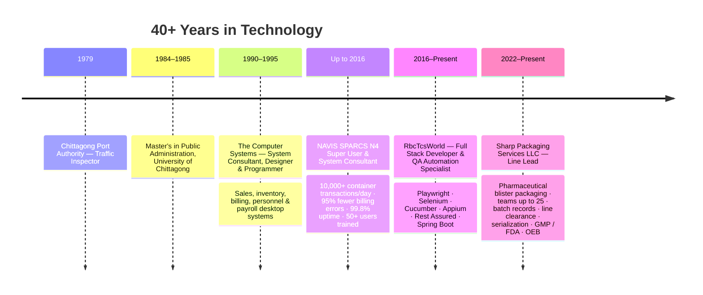

<strong>📄 Detailed experience</strong>

**June 2022–Present — Sharp Packaging Services LLC**
Line Lead for pharmaceutical blister-packaging lines (primary and secondary), leading teams of up to 25 operators. Executes batch records and line clearance, runs serialization, and works under GMP, FDA regulations and OEB (occupational exposure band) handling requirements.

**2016–Present — Self-Employed / RbcTcsWorld**
System Designer, Web Developer, Full Stack Developer & QA Automation Specialist. Enterprise BDD frameworks (Playwright, Selenium, Cucumber), API automation (Rest Assured, Postman), full-stack apps (Java, Python, JavaScript), inventory and payroll systems, healthcare application automation.

**1990–1995 — The Computer Systems (Bangladesh)**
System Consultant, Designer & Programmer. Custom desktop systems for sales management, inventory control, billing, personnel management, personnel banking, and payroll.

**1979–2016 — Chittagong Port Authority (Bangladesh)**
Traffic Inspector, Super User & System Consultant for the NAVIS SPARCS N4 Container Terminal Management System. Billing for 10,000+ container transactions/day, cut billing errors by 95%, trained 50+ users, maintained 99.8% uptime.

---

## 🎓 Education & Training

| Degree | Field | Institution | Year |
|--------|-------|-------------|------|
| Master's Degree | Public Administration | University of Chittagong, Bangladesh | 1984–1985 |
| Continuous Learning | QA Automation, BDD, Modern Web | Online Certifications & Self-Study | 2020–Present |

**Training:**

---

## 🌟 Why Hire Me?

| | |
|---|---|
| 🏛️ **Decades of systems experience** | Deep understanding of complex enterprise systems, process optimization and system design |
| 🤖 **Modern automation expertise** | Production-grade BDD frameworks with Playwright, Selenium, Cypress, Appium and Cucumber |
| 🚦 **Quality gates, not just tests** | Coverage, mutation, contract, accessibility, performance and security gates that block a bad build |
| 🧱 **Full-stack capabilities** | Backend services, APIs and databases for end-to-end solutions |
| ☁️ **Cloud-ready** | Sauce Labs cross-browser testing, AWS infrastructure, CI/CD pipelines |
| 🏠 **Remote-ready** | Disciplined, self-motivated, strong communicator |
| 📚 **Continuous learner** | TypeScript, modern Python patterns, AI-assisted QA |

---

## 💾 Portfolio Apps

### Desktop (macOS)

[-2dd4bf?style=for-the-badge&logo=apple&logoColor=white)](https://rbchy.github.io/rbchy/download.html)

Desktop version of my portfolio, packaged with Electron — runs fully offline. The release page shows the `.dmg`, version notes and file size before downloading.

### 📱 Mobile App (Android · iPhone · desktop)

The website itself is an installable app (PWA) with an offline mode: on Android or desktop Chrome/Edge press **Install app** in the site's menu bar; on iPhone use Safari → Share → **Add to Home Screen**. An Android APK/Play Store bundle (Trusted Web Activity) is built by the [`build Android app`](.github/workflows/android-app.yml) workflow — see the [Bangla setup guide](android/README_BN.md).

---

## 🏗️ How This Repository Works

This repository is the GitHub profile README **and** the website [rbchy.github.io/rbchy](https://rbchy.github.io/rbchy/)
(six languages, installable as an app, with the resume). Nothing here is a build step: GitHub Pages serves the files as they are.

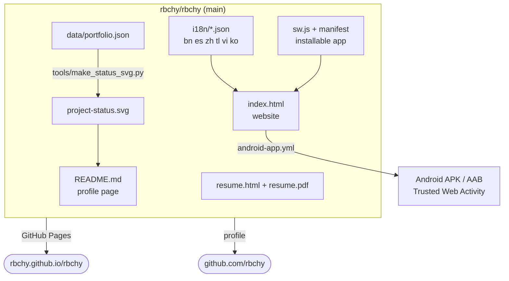

| Workflow | When | What it does |
|---|---|---|
| [`ci.yml`](.github/workflows/ci.yml) — site checks | every push and pull request | numbers in README, website and resume match `data/portfolio.json`; status board up to date; every Mermaid chart renders; all 6 languages translate every text block |
| [`profile-cards.yml`](.github/workflows/profile-cards.yml) | daily 00:30 UTC + manual | draws the profile summary cards into `profile-summary-card-output/` |
| [`snake.yml`](.github/workflows/snake.yml) | daily + manual | contribution-grid snake on the `output` branch |
| [`android-app.yml`](.github/workflows/android-app.yml) | app files change + manual | builds the Android APK and Play Store bundle |

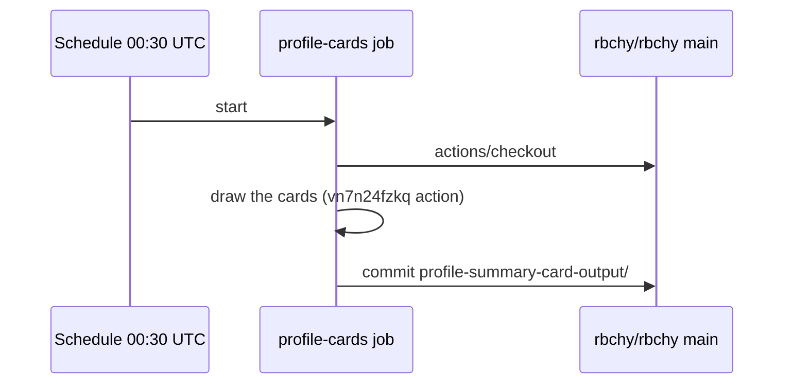

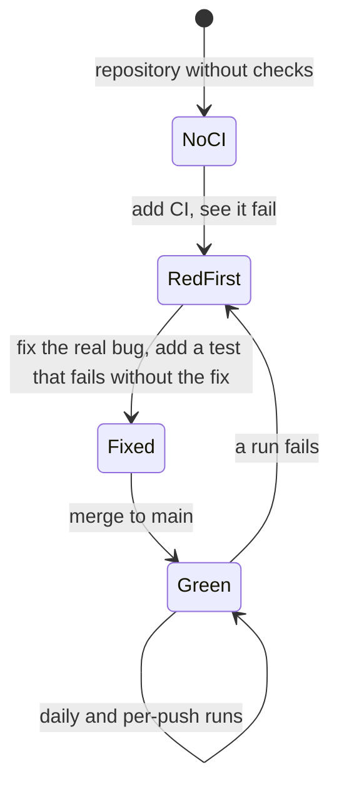

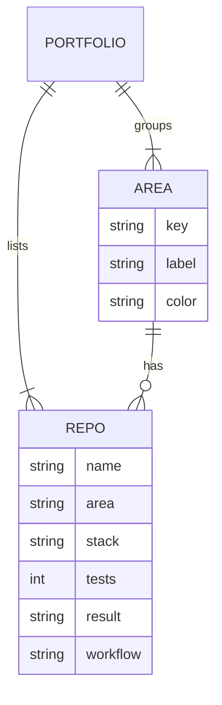

### 🧹 Maintenance Log

| Date | Change |
|---|---|
| 10 Nov 2026 | `profile-cards.yml` fixed: it failed every day (46 runs) because the action ran without `actions/checkout`, so its `git add` had no repository |
| 10 Nov 2026 | New `ci.yml`: data-consistency, status-board, Mermaid and translation checks on every push |
| 10 Nov 2026 | `data/portfolio.json` + `tools/make_status_svg.py`: the status board is drawn from data instead of by hand (it still showed 571 tests) |
| 10 Nov 2026 | README, website (6 languages) and resume updated to the November CI sweep; resume rewritten for a first QA Automation job or internship, with a PDF |
| 4 Nov 2026 | Website installable as an app (PWA + Android TWA build) |

### 📈 Roadmap

- [x] Every repository on green CI, numbers from one data file
- [x] Profile summary cards workflow working again
- [x] ATS-friendly resume as HTML and PDF
- [ ] Use the self-generated profile cards in the GitHub Stats section once a few daily runs have succeeded
- [ ] Android app full screen (assetlinks.json) and Google Play listing
- [ ] RbcTcsWorld Shop live as an Amazon affiliate site

### 🔗 Related Projects

| Project | Why it matters |
|---|---|
| [ranajitchowdhury](https://github.com/rbchy/ranajitchowdhury) | Portfolio repository; owns the original `docs/portfolio.json` mirrored here |
| [RbcTcsWorld](https://github.com/rbchy/RbcTcsWorld) | RbcTcsWorld Shop, 2,039 tests |
| [RbcTcsWorld_ECommerceSuite](https://github.com/rbchy/RbcTcsWorld_ECommerceSuite) | Flagship test system, 1,489 tests |

---

## 📈 GitHub Stats

<picture>
  <source media="(prefers-color-scheme: dark)" srcset="https://raw.githubusercontent.com/rbchy/rbchy/output/github-contribution-grid-snake-dark.svg" />
  <source media="(prefers-color-scheme: light)" srcset="https://raw.githubusercontent.com/rbchy/rbchy/output/github-contribution-grid-snake.svg" />
  
</picture>

---

## 📞 Let's Connect!

%20342--5565-0d9488?style=for-the-badge&logo=phone&logoColor=white)

*"Quality is never an accident; it is always the result of intelligent effort."*

